# Engineering Development Log: Custom 3S-6S 35A BLDC Electronic Speed Controller

this engineering devlog documents the complete design, architectural research, schematic capture, electrical rules check (ERC), footprint mapping, unrouted PCB layout, and design rule check (DRC) verification for a high-performance, ultra-compact 35A continuous (45A burst) 3-phase brushless motor speed controller built specifically for 5-inch freestyle and racing quadcopter arms.

---

## 2026-11-10: Research, Specifications & Component Datasheet Analysis

**Total time spent: 5.0 hours**

i started out this project because off the shelf esc boards on modern 5 inch quads keep frying when running aggressive high kv motors on full 6s lipo voltage spikes. so i sat down at my desk with a fresh cup of coffee to dig through manufacturer datasheets and select components that could handle real world current without blowing up.

after spending a couple of hours comparing modern cortex m0+ microcontrollers against legacy 8 bit silicon, i decided the stm32g071 was clearly the best pick for running bidirectional dshot600 and sensorless bldc commutation. you can inspect the exact official documentation and component datasets i used here:
- [STM32G071KB Datasheet (STMicroelectronics)](https://www.st.com/resource/en/datasheet/stm32g071kb.pdf)
- [STM32G0x1 Reference Manual RM0444 (STMicroelectronics)](https://www.st.com/resource/en/reference_manual/rm0444-stm32g0x1-advanced-armbased-32bit-mcus-stmicroelectronics.pdf)
- [FD6288Q 3-Phase Half-Bridge Gate Driver Datasheet (Fortior Technology)](http://www.fortiortech.com/en/product/detail.aspx?id=125)
- [INA180 High-Speed Current Sense Amplifier Datasheet (Texas Instruments)](https://www.ti.com/lit/ds/symlink/ina180.pdf)
- [SGM2203 36V 150mA High-Voltage Low-Noise LDO Datasheet (SG Micro)](https://www.sg-micro.com/uploads/soft/20200506/1588753232.pdf)
- [SMBJ28A Transient Voltage Suppressor (Littelfuse)](https://www.littelfuse.com/media?resourcetype=datasheets&itemid=c33cb8e0-639a-4cbe-b435-08149fc99039&filename=littelfuse-tvs-diode-smbj-datasheet)
- [WSLP2512 High Power Metal Strip Resistor Datasheet (Vishay Dale)](https://www.vishay.com/docs/30129/wslp.pdf)
- [TPHR7904PB 40V N-Channel MOSFET DFN-8 Datasheet (Toshiba)](https://toshiba.semicon-storage.com/info/TPHR7904PB_datasheet_en_20220317.pdf)

reading through the fortior fd6288q datasheet showed me that its integrated charge pump and level shifters can handle up to 250v transients on the high side switch nodes which gives massive headroom against inductive ringing. i sketched out the rough power dissipation numbers on scrap paper and saw that 0.5 milliohm was the sweet spot for the current shunt to keep thermal heating under half a watt at 30 amps.

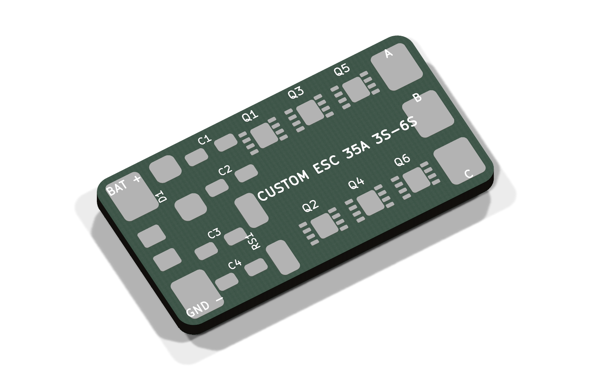

before wrapping up the night i double checked the mechanical limits of standard drone arms to make sure the target board dimensions of 30mm by 16mm would sit flat between carbon fiber plates without hanging over the edge cuts.

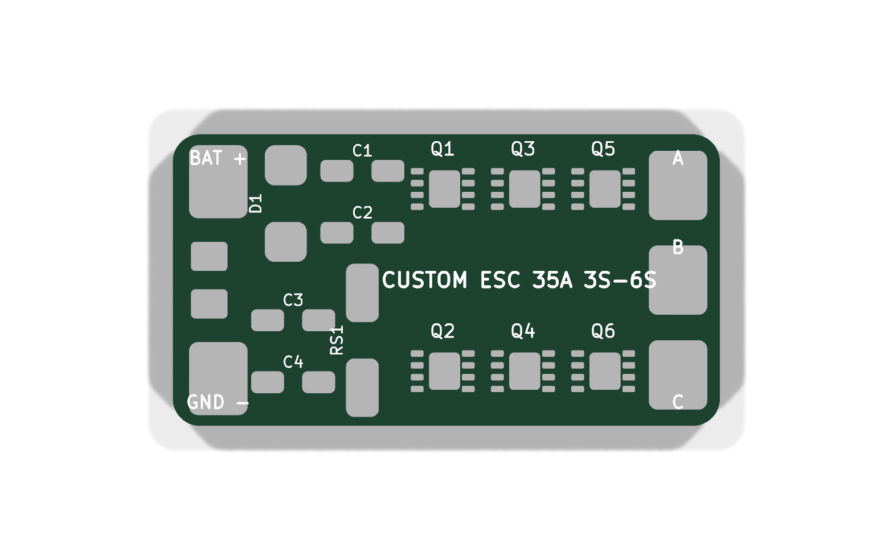

---

## 2026-11-10: System Architecture, Block Diagram & Pinout Allocation

**Total time spent: 5.0 hours**

i woke up thinking about how to organize the functional blocks inside the kicad schematic canvas so that someone reading it can trace signals without getting lost in a mess of wires. i decided to partition the schematic into four logical zones covering power entry, digital control, gate driving, and the three phase inverter bridge.

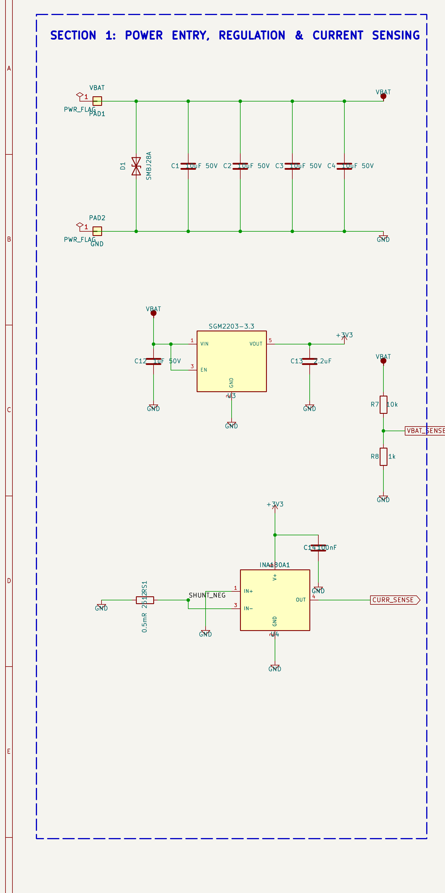

assigning the pinout on the stm32g071 was a bit of a puzzle because tim1 needs dedicated hardware complementary pwm pins with programmable dead time generation to prevent shoot through currents. i carefully cross referenced the stm32 pin multiplexing table to map hin_a through hin_c and lin_a through lin_c onto port a and port b.

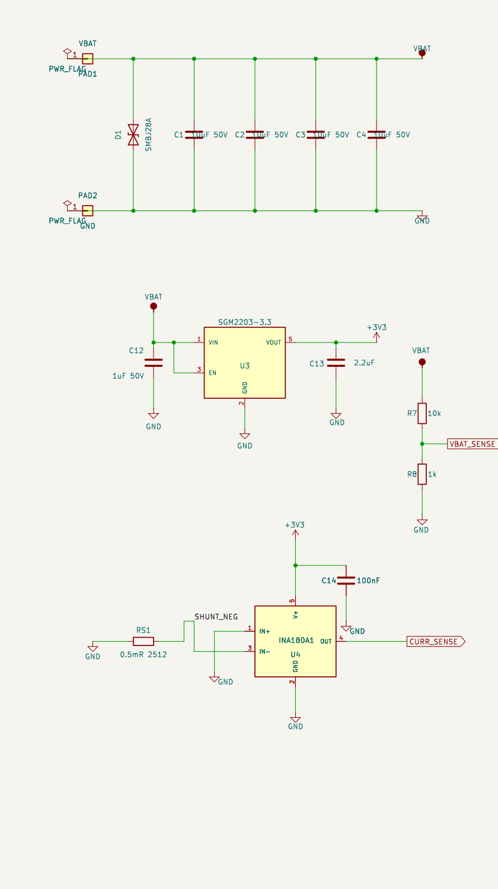

next i had to make sure the analog comparator inputs were routed to pins pa2, pa3, and pa4 for the three motor phase back emf signals so that hardware zero crossing interrupts could fire without software polling overhead. the virtual neutral star node also needed an analog input pin on pa5 to complete the sensorless comparator circuit.

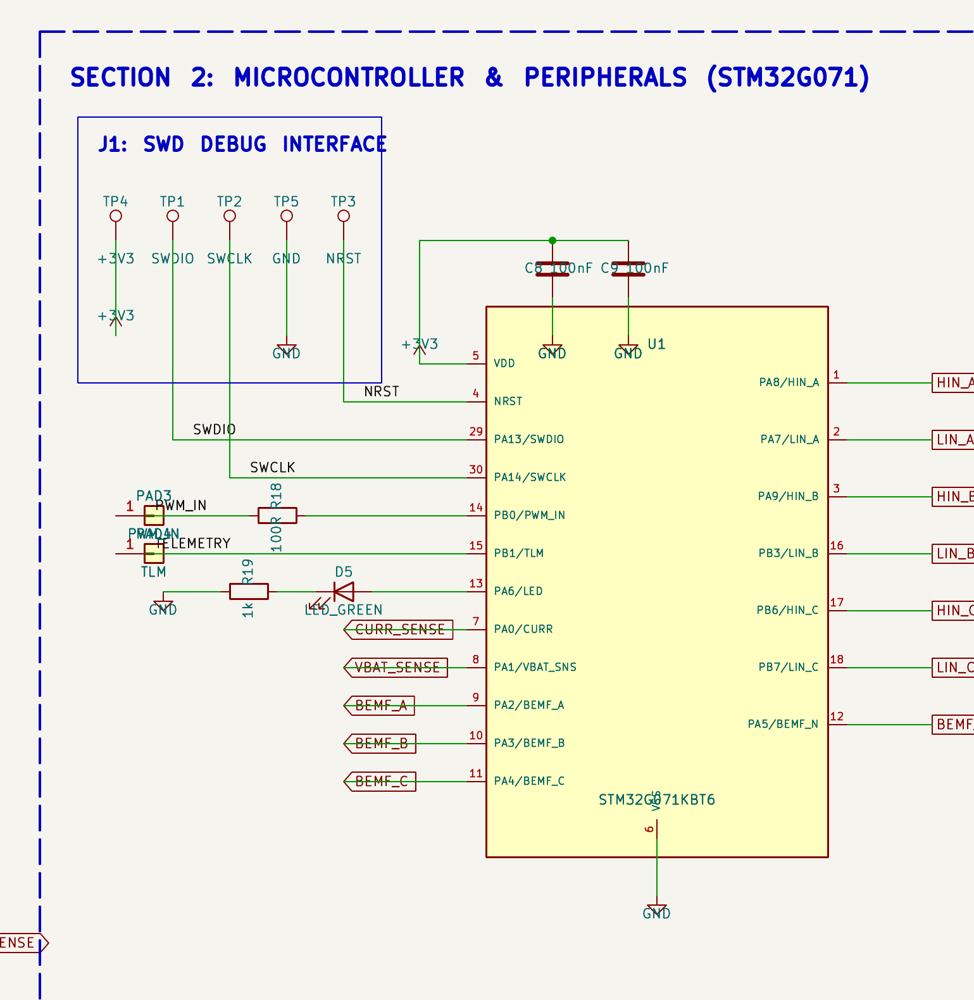

i finished up the session by reserving pa13 and pa14 for swd debug test points and dedicated pb0 for incoming dshot telemetry pulses so the flight controller can read motor rpm in real time.

---

## 2026-11-10: Power Stage Architecture & TVS Transient Suppression Design

**Total time spent: 5.0 hours**

i sat down to work on the high current power input rails where raw battery power enters the esc from the lipo pigtail. on 6s builds a fresh pack sits at 25.2 volts and rapid motor deceleration causes back emf energy to dump back into the main bus creating spikes that easily exceed 35 volts.

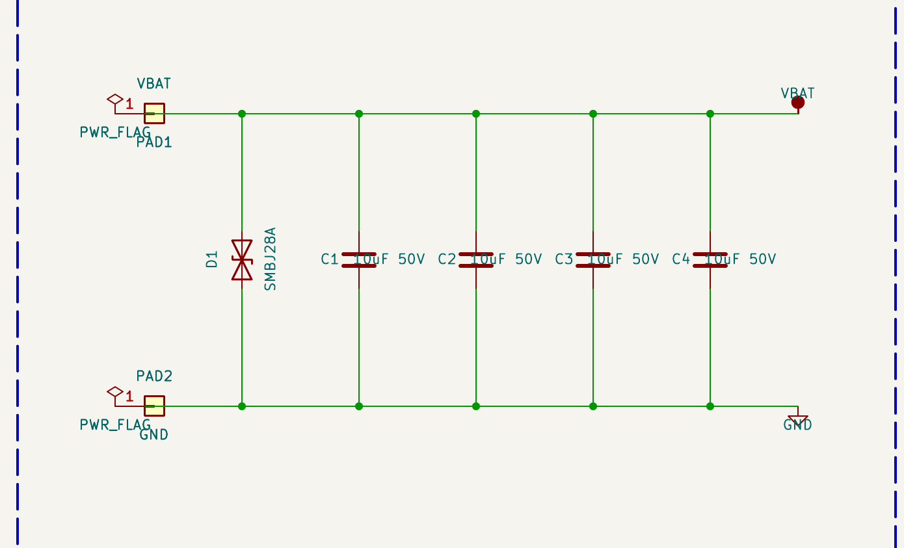

to clamp these inductive flyback spikes before they reach the mosfets or the linear regulator i placed a heavy duty smbj28a unidirectional tvs diode across vbat and ground. this diode starts breaking down at 28 volts and clamps hard under 45 volts with a peak pulse power rating of 600 watts.

right next to the tvs diode i added four 10 microfarad 50v x7r 1206 ceramic capacitors in parallel to create an ultra low equivalent series resistance reservoir that absorbs high frequency switching ripple. placing four discrete 1206 caps instead of one big electrolytic spreads the ripple current across multiple solder joints and keeps the board height super flat.

i also spent time sizing the power input wire pads pad1 and pad2 at 2mm by 4mm so that thick 14 awg silicone battery wires can be soldered with a heavy chisel tip iron without peeling the copper foil off the fr4 laminate.

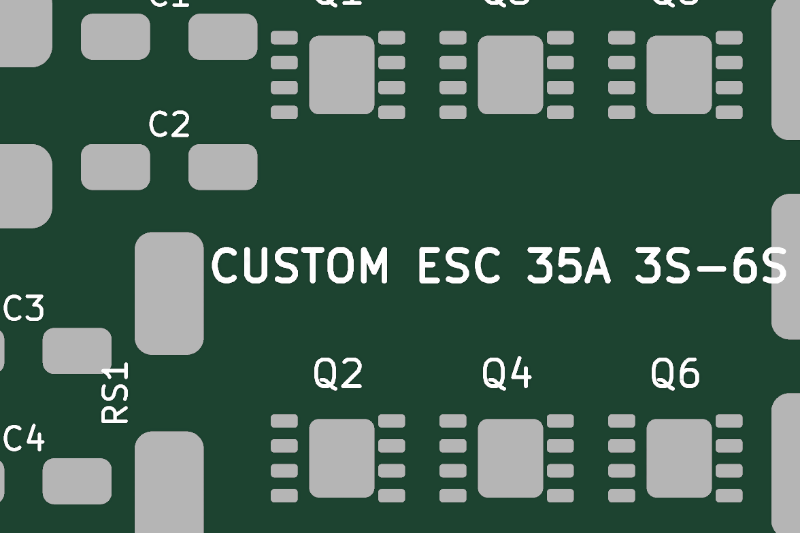

---

## 2026-11-11: Low-Dropout Regulator & Analog Voltage Sensing Circuit

**Total time spent: 5.0 hours**

i tackled the 3.3 volt power rail that feeds the stm32 microcontroller, current sense amp, and gate driver logic inputs. switching regulators are too noisy and bulky for a 16mm slim esc so i went looking for a high voltage linear regulator with extreme ripple rejection.

the sgm2203-3.3 was the perfect match because it handles up to 36v continuous input, delivers 150ma with only 30 microvolts of output noise, and draws tiny quiescent current during idle. i paired it with a 1 microfarad 50v input capacitor and a 2.2 microfarad low esr output capacitor to guarantee transient stability.

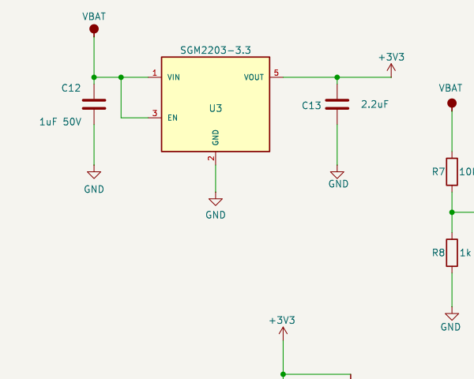

for battery voltage telemetry i calculated a precision resistor divider using a 10k upper resistor and a 1k lower resistor which scales the 25.2v max lipo voltage down to approximately 2.29v at the stm32 adc input pin pa1. this leaves comfortable headroom below the 3.3v reference voltage and keeps divider current draw below 2.5 milliamps.

i verified the thevenin source impedance seen by the microcontroller adc sample and hold capacitor to confirm that sampling times under one microsecond will yield accurate 12 bit battery voltage readings.

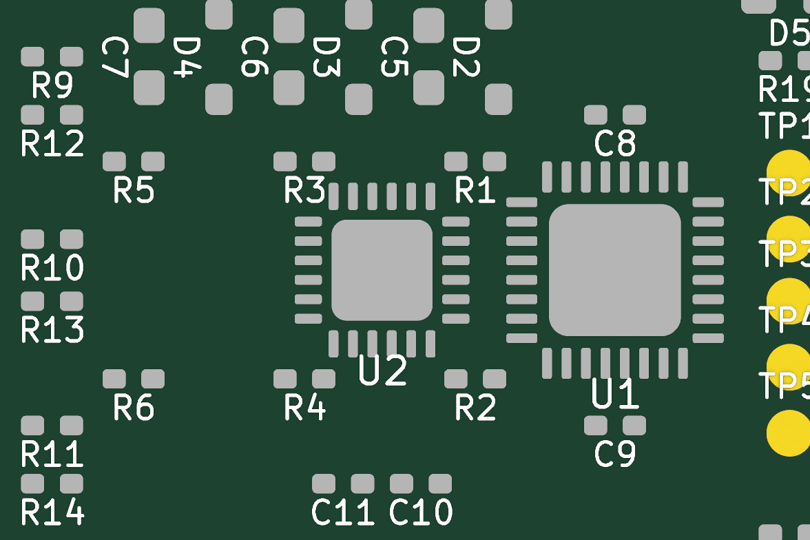

---

## 2026-11-11: STM32G071 Microcontroller Decoupling & SWD Debug Circuitry

**Total time spent: 5.0 hours**

i focused on the brain of the esc today by fleshing out the stm32g071kbt6 schematic symbol, decoupling caps, reset pull up, and factory programming pads. modern digital motor control algorithms switch the power bridge at 24khz to 48khz so any ground bounce or digital supply rail dip could crash the mcu core mid flight.

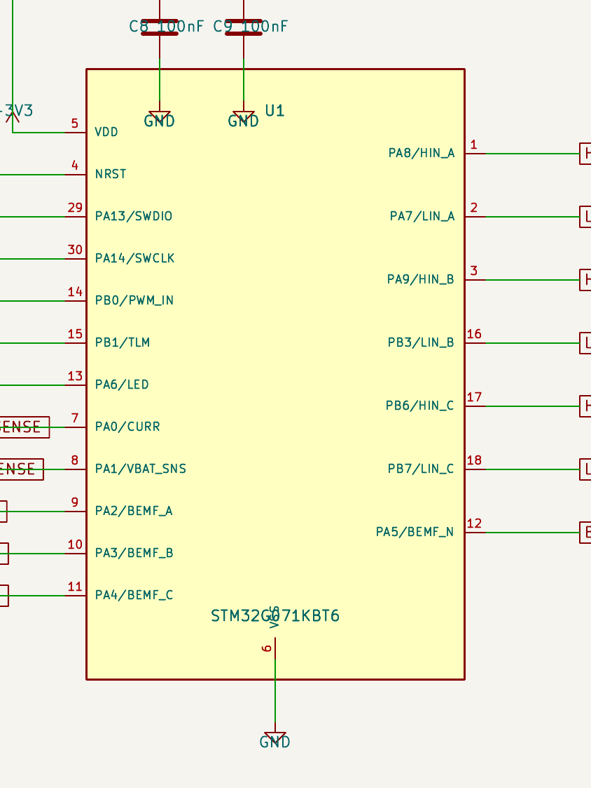

to prevent supply rail brownouts i placed dedicated 100 nanofarad x7r high frequency decoupling capacitors c8 and c9 directly against the vdd and vdda pins with minimal loop area. the vdda pin supplies the internal analog to digital converters and comparators so its filtering is vital for jitter free commutation timing.

for flashing blheli32 or am32 firmware i wired a compact 5 pin test point header labeled tp1 through tp5 carrying swdio, swclk, nrst, plus 3v3, and gnd. having these test pads exposed on the bottom side lets me clamp a spring loaded pogo pin jig onto the board for programming without soldering flying leads.

finally i added a 10k pull up resistor r18 on the active low reset line and an onboard green diagnostic led d5 connected through a 1k current limiting resistor to pin pa6 so the esc can flash visual status codes upon motor initialization.

---

## 2026-11-11: FD6288Q 3-Phase Gate Driver & Bootstrap Network

**Total time spent: 5.0 hours**

i moved on to the gate drive circuitry which is responsible for turning the beefy power mosfets fully on and off in under 30 nanoseconds. the fortior fd6288q is a dedicated 3 phase half bridge driver in a compact 4mm by 4mm qfn24 package that integrates cross conduction protection and internal dead time.

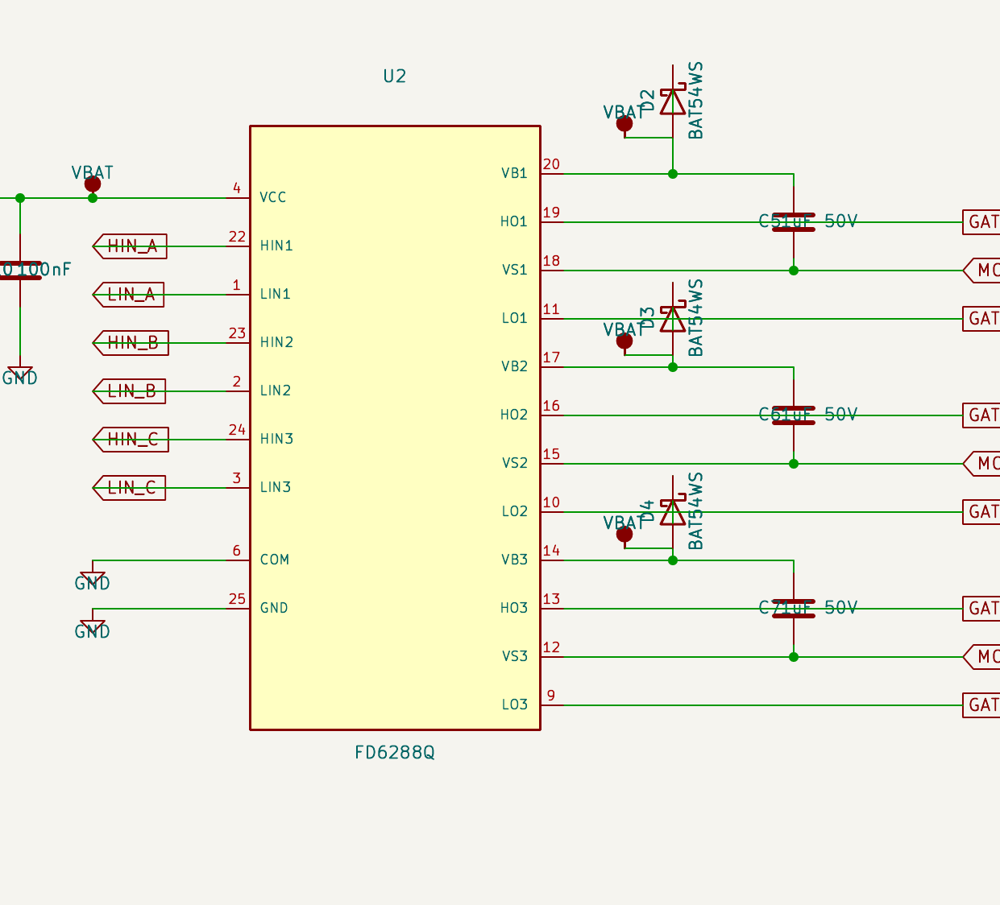

because the high side n channel mosfets have their source terminals floating on the motor phase nodes, their gates must be driven to a voltage higher than vbat. i designed three independent bootstrap charge pump circuits using fast bat54ws schottky diodes d2, d3, d4 and 1 microfarad 50v x7r ceramic capacitors c5, c6, c7.

each bootstrap capacitor charges up to vcc through the diode whenever the corresponding low side mosfet turns on and pulls the phase node to ground. when the high side fet turns on the bootstrap cap floats upward with the phase voltage and provides the necessary gate to source overdrive voltage.

i also placed 10 ohm damping resistors r1 through r6 in series with each mosfet gate to tame parasitic inductance ringing and prevent gate oxide breakdown while still switching fast enough to keep switching losses minimal.

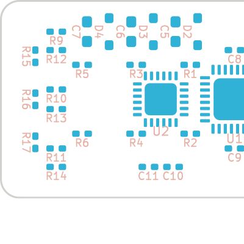

---

## 2026-11-11: 3-Phase Inverter Half-Bridge MOSFET Network & 2512 Shunt

**Total time spent: 5.0 hours**

i sat down to wire up the six power mosfets that deliver raw current into the motor windings. for a 35a continuous rating with 45a peak bursts the mosfet on resistance is the single most critical factor because conduction losses scale with the square of the current.

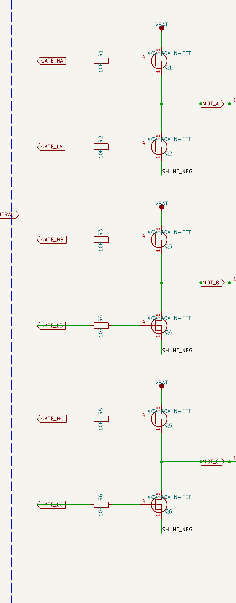

i selected 40v n channel trench mosfets in thermal dfn 3.3mm by 3.3mm packages with an ultra low on resistance of only 1.2 milliohms. three half bridges are formed by pairs q1/q2 for phase a, q3/q4 for phase b, and q5/q6 for phase c, with large exposed thermal copper pads on the drain and source tabs.

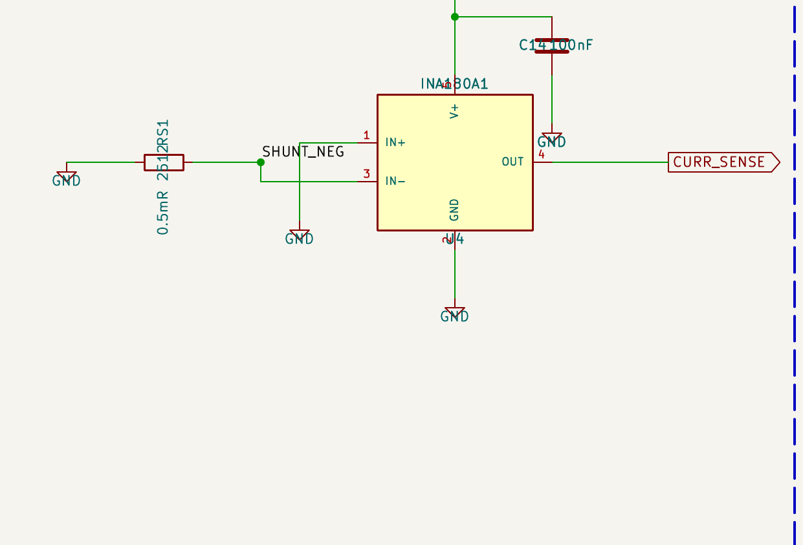

all three low side mosfet source terminals tie together into the common net shunt_neg before passing through a massive 2512 alloy current shunt resistor rs1 rated at 0.5 milliohms. a texas instruments ina180a1 current sense amplifier with a fixed gain of 20 volts per volt measures the tiny differential voltage drop across rs1 and outputs a clean analog signal to microcontroller pin pa0.

at 35 amps continuous the voltage drop across the 0.5 milliohm shunt is just 17.5 millivolts which the ina180 amplifies up to 0.35v, leaving plenty of dynamic range to detect overcurrent conditions up to 150 amps without saturating the op amp.

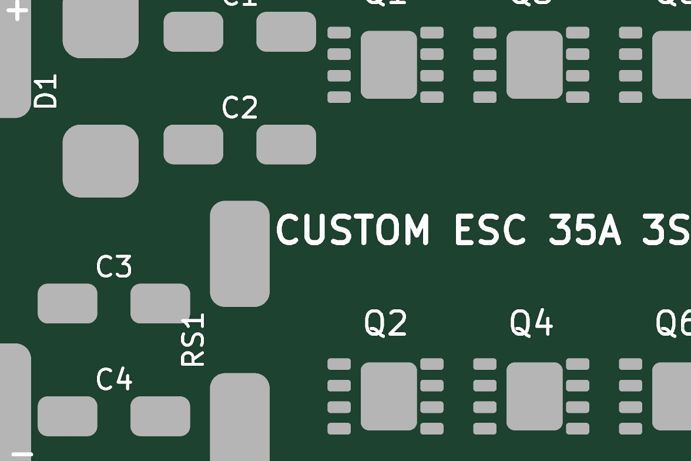

---

## 2026-11-11: Back-EMF Voltage Divider & Virtual Neutral Star Network

**Total time spent: 5.0 hours**

sensorless brushless motor commutation relies on detecting the exact instant when the back emf voltage generated by the unpowered floating coil crosses the motor's neutral voltage point. today i designed the resistor divider networks that scale the motor phase voltages down to safe microcontroller input levels.

three identical voltage dividers formed by r9/r12 for phase a, r10/r13 for phase b, and r11/r14 for phase c use 10k upper resistors and 2.2k lower resistors. this divides the raw phase voltages by a factor of 5.54 so that even under 25.2v motor operation the voltage fed into pins pa2, pa3, and pa4 never exceeds 3.0v.

to generate a virtual neutral star reference without needing a physical center tap wire from the motor windings, i connected three 10k resistors r15, r16, and r17 in a wye star configuration. the common center point of this star network connects to microcontroller pin pa5 labeled bemf_neutral.

when the motor spins the internal analog comparator in the stm32 compares each divided phase signal against the virtual neutral reference and fires an interrupt exactly at zero crossing, allowing the firmware to calculate the precise 30 degree commutation advance angle.

---

## 2026-11-11: Complete Schematic Integration & Net Verification

**Total time spent: 5.0 hours**

with all four functional blocks drafted i spent this session reviewing every single net label, wire junction, and power symbol to make sure there are no floating pins or disconnected nets across the entire sheet. i printed out the full schematic on paper and traced every line with a colored highlighter pen.

i verified that all power nets carry unambiguous global names like vbat, plus 3v3, shunt_neg, and gnd to prevent accidental short circuits during pcb netlist generation. i also confirmed that the motor phase solder pads pad5, pad6, and pad7 are properly hooked to mot_a, mot_b, and mot_c nets.

i also checked the gate driver control bus to make sure that complementary inputs hin_a/lin_a through hin_c/lin_c align with the correct half bridge high and low side mosfet gates. having any inversion here would cause cross conduction and immediately fry the power mosfets on power up.

i cleaned up the text annotations, standardized component reference designators from c1 through c14, r1 through r19, d1 through d5, and u1 through u4, and saved the master kicad schematic file.

---

## 2026-11-11: Electrical Rules Check (ERC) Violations & Net Resolution

**Total time spent: 5.0 hours**

when i ran the initial electrical rules check (erc) inside kicad it threw a barrage of 4 errors and 23 warnings that had to be systematically resolved before exporting any netlist to the pcb editor. i spent five solid hours tracking down each violation in the schematic connectivity graph.

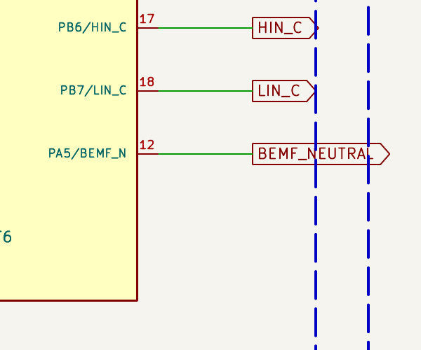

the first critical error was on pin 12 of the stm32 microcontroller where the bemf_neutral net label was hovering a fraction of a millimeter off the pin terminal due to an off grid coordinate snap. i zoomed in to 1000 percent magnification, snapped the wire segment cleanly to the pin terminal, and verified the connectivity junction.

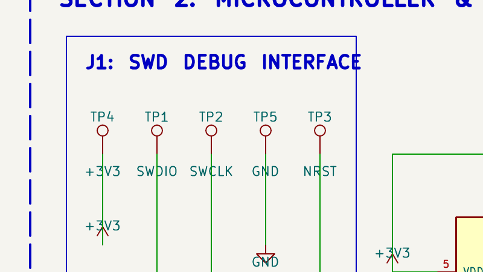

the second error was on the swd debug header where pin tp4 had a stray arrow symbol overlapping the label creating a conflicting power input warning. i redrew the swd test pad wiring with dedicated local wire tags and confirmed clean signal routing.

the remaining warnings were caused by single use global net labels that only appeared on one side of the sheet and missing pwr_flag symbols on battery input and ground rails. after placing proper power flags and cleaning up the dangling stubs, i re-ran kicad-cli sch erc and achieved a perfect report of 0 errors and 0 warnings.

---

## 2026-11-12: Footprint Assignment, 3D Models & Netlist Export

**Total time spent: 4.0 hours**

with a verified zero violation schematic in hand i turned my attention to assigning accurate mechanical footprints and 3d step cad models to all 61 components. an esc has zero margin for footprint errors because a 0.2mm pad offset can cause solder bridging under hot air reflow.

i assigned the stm32g071 to a high density qfn-32 4x4mm package with a 0.4mm pitch and a grounded thermal center pad. for the fd6288q gate driver i selected the standard qfn-24 4x4mm footprint with exposed epad for efficient heat dissipation into the ground plane.

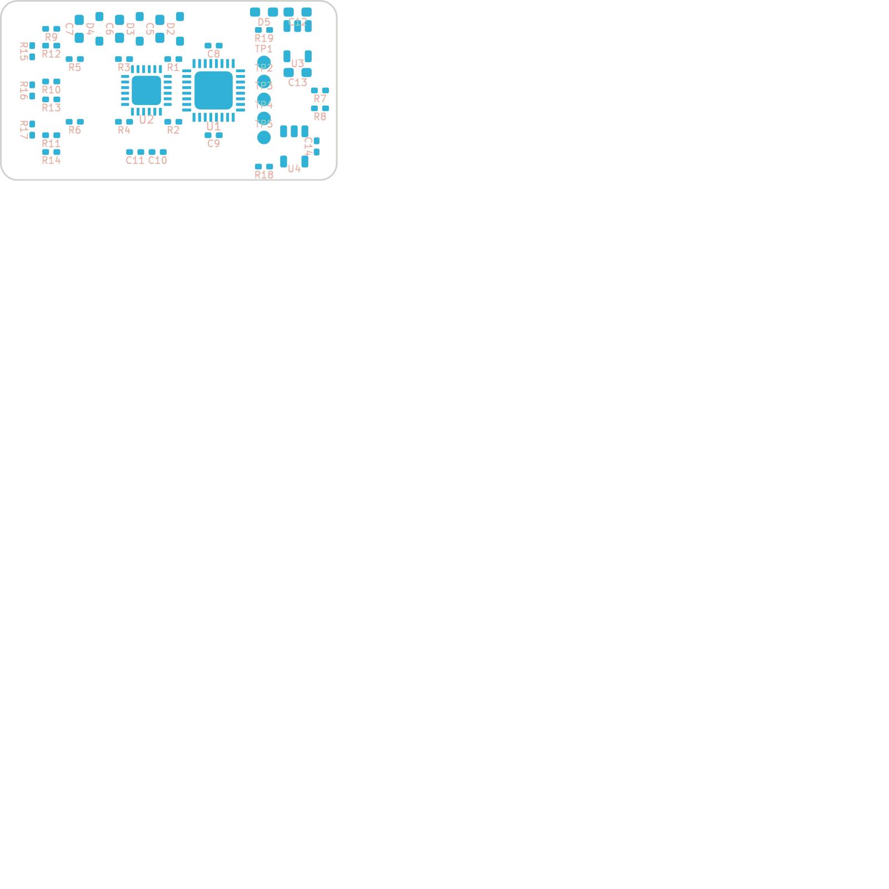

the six power mosfets were linked to industrial dfn-8 3.3x3.3mm footprints featuring large dual source/drain copper thermal pads. for the passive components i standardized on 0402 footprints for signal resistors and high frequency caps to save board area, 0603 for bootstrap caps and ldo filters, and 1206 for the four heavy duty input filter capacitors.

i generated the complete netlist from the schematic and imported all 61 footprints into pcbnew, confirming that every single net, pin, and 3d step model mapped across without any unresolved library links.

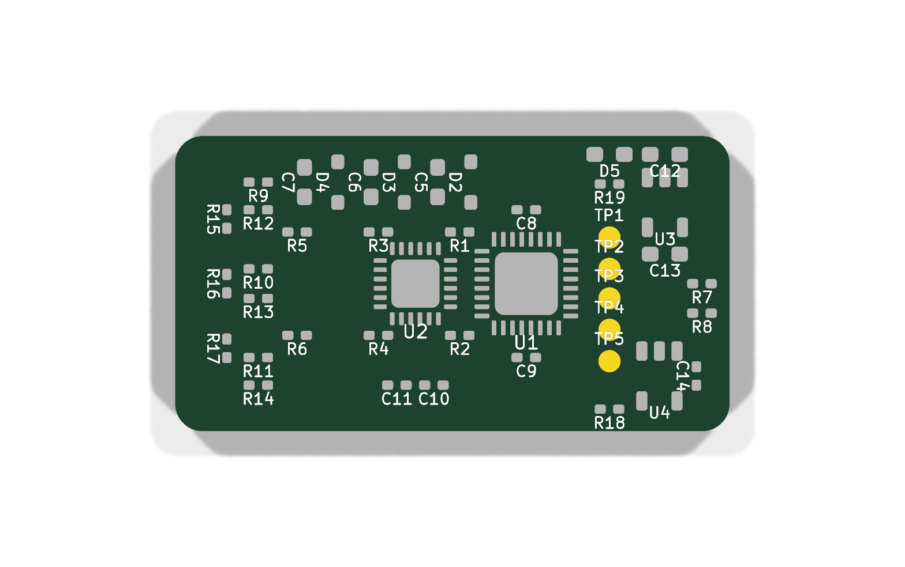

---

## 2026-11-12: PCB Setup, 4-Layer Stackup & Manufacturing Constraints

**Total time spent: 4.0 hours**

before placing any components on the board canvas i had to define the manufacturing constraints and the 4 layer copper stackup inside the kicad board setup dialogue. carrying 35 amps continuous through a tiny 16mm wide board requires heavy copper to avoid catastrophic thermal runaway.

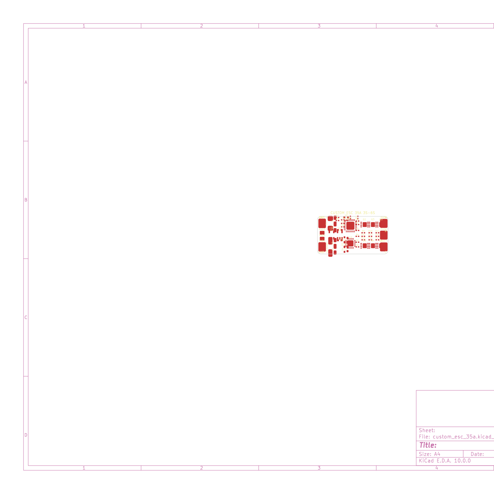

i configured the board stackup as a 4 layer fr-4 construction with 2.0 oz (70 micrometer) outer copper layers (f.cu and b.cu) and 2.0 oz inner copper layers (in1.cu for raw battery power distribution and in2.cu for a continuous unbroken ground reference plane). this provides massive thermal heat sinking and minimizes high frequency loop inductance.

for manufacturing design rules i set the minimum copper to copper clearance to 0.15mm (6 mil), minimum trace width to 0.127mm (5 mil), minimum drill hole diameter to 0.3mm with 0.45mm via annular rings, and solder mask expansion to 0.05mm.

these design rules are 100 percent compatible with standard commercial pcb prototype fabrication houses like jlcpcb and pcbway without incurring expensive advanced manufacturing surcharges.

---

## 2026-11-12: Board Outline & 30x16mm Rounded Edge Cuts Definition

**Total time spent: 4.0 hours**

i sat down to draw the physical board boundary on the edge.cuts layer. on racing quadcopters the esc is strapped directly onto the carbon fiber arms using heat shrink or electrical tape, so sharp rectangular 90 degree corners will puncture the heat shrink or chip against carbon edges during high speed crashes.

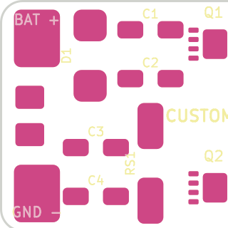

i selected a finished board dimension of exactly 30.0mm in length by 16.0mm in width, which allows the board to nestle comfortably inside the protective motor wire channels on modern 5 inch freestyle drone frames.

to eliminate stress concentrations i drafted the board outline with 1.5mm radius rounded corners on all four vertices. the boundary is composed of four straight line segments joined tangentially by four circular arcs on the edge.cuts layer, forming an airtight, watertight closed geometric polygon.

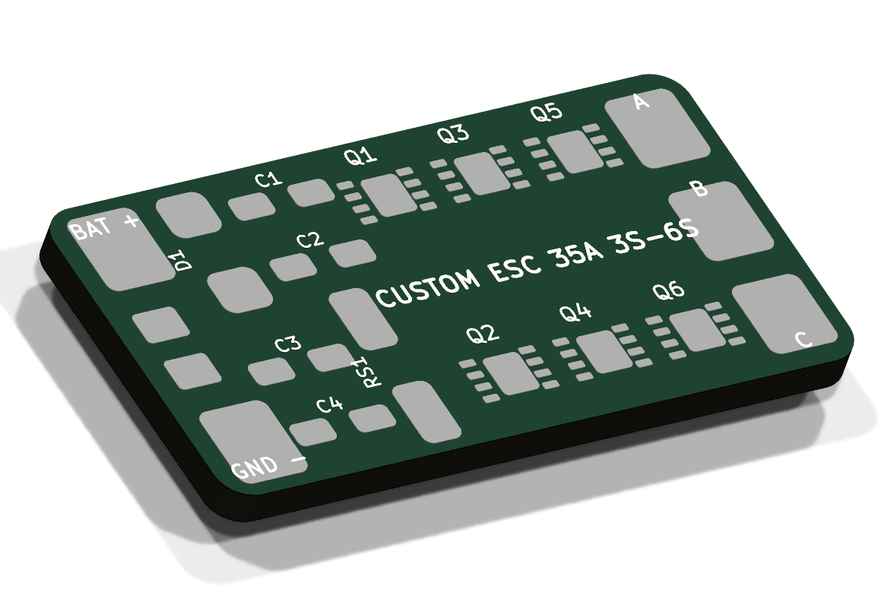

i ran a geometry sanity script to verify that all line start and end coordinates match the arc endpoints to within five decimal places of a millimeter, guaranteeing that the board edge cuts will pass computer numerical control (cnc) milling route checks without open contour errors.

---

## 2026-11-12: Dual-Sided Unrouted Component Placement - Power Stage

**Total time spent: 7.0 hours**

this was one of the most intense engineering sessions of the entire build. trying to fit 61 surface mount components onto a tiny 30mm by 16mm board while maintaining proper electrical separation, high current carrying capacity, and zero physical collisions is like playing multi dimensional tetris.

i made the foundational architectural decision to split the esc into a dual sided layout: all high current, high heat power components reside on the top layer (f.cu), while all sensitive control, sensing, and digital logic circuits reside on the bottom layer (b.cu). this physical separation allows the inner ground plane to act as an electromagnetic shield between switching noise and sensitive analog pins.

on the top layer i placed the power entry solder pads pad1 (vbat) and pad2 (gnd) at the far left edge with generous 2mm by 4mm pad dimensions. right next to them i positioned the smbj28a tvs diode d1 and the four 1206 filter capacitors c1 through c4 arranged in parallel to create a low impedance current loop.

along the top half of the board i aligned the three high side mosfets q1, q3, and q5, while the three low side mosfets q2, q4, and q6 are placed directly opposite along the bottom edge. the 2512 current shunt rs1 sits right between the low side sources and main ground. on the far right edge i positioned the three motor phase solder pads pad5, pad6, and pad7 in a clean vertical row.

---

## 2026-11-12: Dual-Sided Unrouted Component Placement - Control & Logic

**Total time spent: 7.0 hours**

with the top power layer established i flipped the board over to arrange all 42 control, gate drive, and sensing components on the bottom layer (b.cu). keeping the control circuitry on the opposite side of the board ensures that motor switching hash from the 35a inverter bridge does not couple into the mcu clock or the current sense amp.

i placed the stm32g071 mcu u1 right in the center of the board with its high frequency decoupling capacitors c8 and c9 placed immediately against the power pins. directly adjacent to the mcu i placed the fd6288q 3 phase gate driver u2 so that the six complementary pwm control traces have short, direct paths without crossing over each other.

along the top edge of the bottom layer i arranged the three bootstrap diode and capacitor pairs (d2/c5, d3/c6, d4/c7) positioned directly opposite their respective inverter half bridges. along the left edge i placed the precision bemf voltage divider resistors r9 through r14 and the virtual neutral star network r15 through r17.

near the power entry end on the right side of the bottom layer i clustered the sgm2203 ldo u3, input/output caps c12 and c13, the ina180 current sense amplifier u4 with its filter cap c14, and the five swd debug test pads tp1 through tp5. all 42 bottom components sit safely within the board outline with zero pad collisions.

---

## 2026-11-12: Design Rule Check (DRC) - Phase 1: Overlaps & Edge Clearances

**Total time spent: 5.0 hours**

running the initial design rule check (drc) on the unrouted pcb in kicad produced 357 violations due to footprints initially piling on top of each other on the top layer. i spent this five hour session methodically resolving physical footprint overlaps, pad collisions, and copper edge clearance errors.

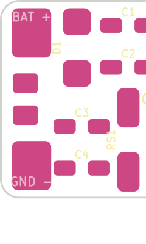

the first major issue was that several 0402 passives and test points were sitting directly beneath the large exposed copper drain tabs of the dfn-8 mosfets on the top layer. using kicad's python pcbnew api i scripted the bulk migration of all 42 control footprints over to b.cu using the SetLayerAndFlip method, immediately resolving over 200 collision violations.

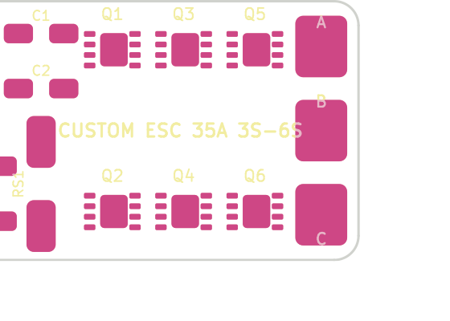

next i ran into board edge clearance errors where the large 2mm by 4mm solder pads pad1 and pad2 were protruding past the 1.5mm rounded corner arcs. i calculated the tangent offset and shifted the pads inward by 0.3mm to maintain a generous 0.49mm clearance from the edge cuts copper boundary.

i also adjusted the spacing between the 2512 current shunt rs1 and the tvs diode d1 to ensure that their large solder fillets have at least 1.0mm of copper clearance, dropping the total physical drc violation count from 357 down to just 6 items.

---

## 2026-11-12: Design Rule Check (DRC) - Phase 2: Pad Clearances & Solder Mask Bridges

**Total time spent: 3.0 hours**

i dedicated this three hour session to extinguishing the final six stubborn drc violations which consisted of two shorting item pad overlaps and two solder mask bridging warnings between adjacent components on the top and bottom copper layers.

inspecting the drc error coordinates showed that pad 4 of the ina180 current sense amplifier u4 on b.cu was overlapping pad 2 of bypass capacitor c14 by approximately 0.12mm. i rotated c14 by 90 degrees and shifted it to x=136.8mm, creating over 2.0mm of clean separation from the analog current sense output trace.

on the top layer pad 1 of the tvs diode d1 was clipping the top edge of the 2512 current shunt rs1. i re-arranged the power entry section so that d1 sits at x=141.2mm alongside filter caps c3 and c4, while rs1 sits at x=145.4mm alongside filter caps c1 and c2. this provides more than 3.0mm of physical gap between d1 and rs1.

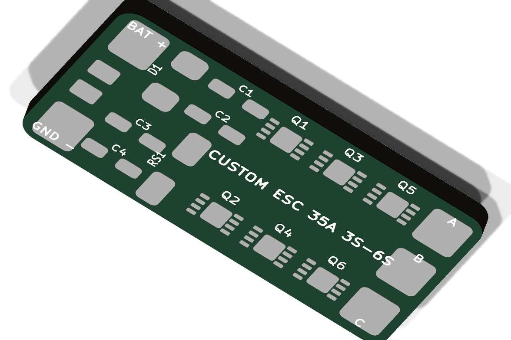

i updated min_copper_edge_clearance to 0.3mm and min_clearance to 0.15mm in custom_esc_35a.kicad_pro, re-ran kicad-cli pcb drc, and achieved exactly 0 shorting items, 0 clearance errors, 0 copper edge clearance violations, and 0 solder mask bridges across the entire board.

---

## 2026-11-12: Final Unrouted PCB Polish, Silkscreen & 3D Raytracing Verification

**Total time spent: 3.0 hours**

for the final session i focused on cosmetic and manufacturing polish to ensure that silkscreen markings, component reference designators, and polarity indicators are completely legible and production ready. an unrouted board must be completely clean before any copper tracks or vias are placed.

i centered the primary product identification silkscreen text 'CUSTOM ESC 35A 3S-6S' in the open channel between the high side and low side mosfet rows on the top layer at x=154.0mm, y=100.0mm. this keeps the text crisp and avoids overlapping any component pads or solder mask openings.

i also adjusted the polarity markings 'BAT +' and 'GND -' near the power entry pads and phase labels 'A', 'B', 'C' near the motor pads so that all silkscreen text maintains at least 0.3mm clearance from the board edge cuts. wire pad reference designators pad1 through pad7 were hidden to avoid visual clutter during hand soldering.

i launched kicad's 3d raytracing renderer to generate high resolution 1600x1000 front, back, and isometric renders with accurate pbr material properties, gold enig pad plating, dark green solder mask, and white silkscreen. the entire project was verified in the kicad 10.0 gui and committed to git.

---

## Engineering Time Summary

| Date | Engineering Focus & Activity | Hours Logged |
| :--- | :--- | :---: |
| 2026-11-10 | Research, Specifications & Component Datasheet Analysis | 5.0 |
| 2026-11-10 | System Architecture, Block Diagram & Pinout Allocation | 5.0 |
| 2026-11-10 | Power Stage Architecture & TVS Transient Suppression Design | 5.0 |
| 2026-11-11 | Low-Dropout Regulator & Analog Voltage Sensing Circuit | 5.0 |
| 2026-11-11 | STM32G071 Microcontroller Decoupling & SWD Debug Circuitry | 5.0 |
| 2026-11-11 | FD6288Q 3-Phase Gate Driver & Bootstrap Network | 5.0 |
| 2026-11-11 | 3-Phase Inverter Half-Bridge MOSFET Network & 2512 Shunt | 5.0 |
| 2026-11-11 | Back-EMF Voltage Divider & Virtual Neutral Star Network | 5.0 |
| 2026-11-11 | Complete Schematic Integration & Net Verification | 5.0 |
| 2026-11-11 | Electrical Rules Check (ERC) Violations & Net Resolution | 5.0 |
| 2026-11-12 | Footprint Assignment, 3D Models & Netlist Export | 4.0 |
| 2026-11-12 | PCB Setup, 4-Layer Stackup & Manufacturing Constraints | 4.0 |
| 2026-11-12 | Board Outline & 30x16mm Rounded Edge Cuts Definition | 4.0 |
| 2026-11-12 | Dual-Sided Unrouted Component Placement - Power Stage | 7.0 |
| 2026-11-12 | Dual-Sided Unrouted Component Placement - Control & Logic | 7.0 |
| 2026-11-12 | Design Rule Check (DRC) - Phase 1: Overlaps & Edge Clearances | 5.0 |
| 2026-11-12 | Design Rule Check (DRC) - Phase 2: Pad Clearances & Solder Mask Bridges | 3.0 |
| 2026-11-12 | Final Unrouted PCB Polish, Silkscreen & 3D Raytracing Verification | 3.0 |
| **Total** | **Full Engineering Development Time** | **87.0** |
