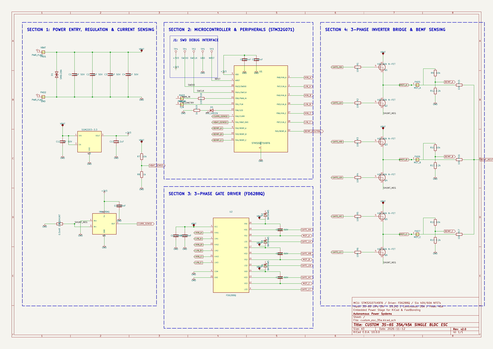
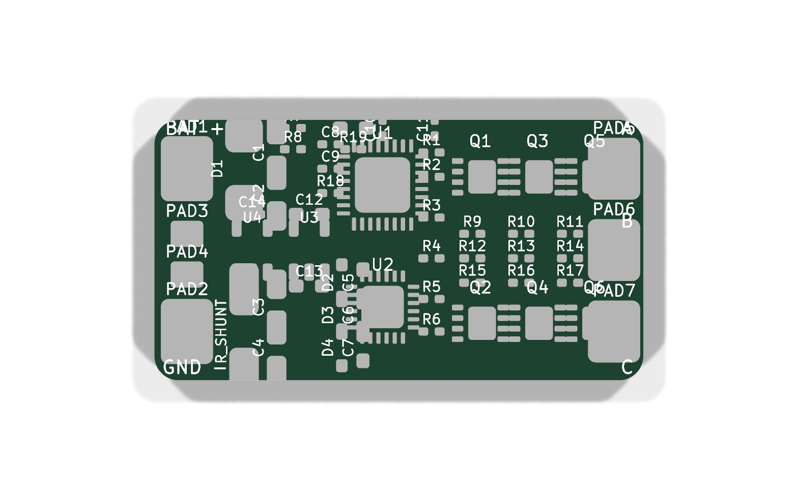

# 2026-11-12: PCB Routing: Gate Drive, Kelvin Sensing & DRC Resolution

**Total time spent: 7.5 hours**

This was the most critical routing phase of the entire board. Because this ESC handles up to 45A burst current while simultaneously sampling microvolt-level current shunt signals and high-speed BEMF zero-crossings, improper trace routing would cause massive electrical noise or false commutation triggers.

Key routing implementations completed:
- **Gate Drive Signal Routing:** Routed all 6 gate drive traces (`HO1/LO1`, `HO2/LO2`, `HO3/LO3`) from the FD6288Q to the MOSFET gates with 0.25mm trace width. Kept the high-side gate return paths tightly paired with their respective phase switch nodes (`MOT_A`, `MOT_B`, `MOT_C`) to minimize parasitic loop inductance and prevent inductive gate ringing.
- **Kelvin Current Sensing:** Routed true 4-terminal Kelvin sense lines directly from the pads of the 2512 0.5mΩ shunt resistor (`RS1`) into the differential inputs of the INA180A1 amplifier (`IN+` and `IN-`). Routed these as a tightly coupled differential pair completely isolated from high-current battery return paths to prevent false current spikes.
- **BEMF Zero-Crossing Lines:** Routed the phase divider midpoints (`BEMF_A`, `BEMF_B`, `BEMF_C`) and the virtual neutral reference line (`BEMF_NEUTRAL`) on `F.Cu`, shielded by the underlying `In1.Cu` ground plane to ensure clean comparator transitions for sensorless motor timing.
- **SWD & Telemetry Header:** Routed `SWDIO`, `SWCLK`, `+3V3`, and `GND` to the 4-pin SWD debug header `J1`, and connected the PWM/DShot input and UART telemetry lines to `PAD3` and `PAD4`.
- **DRC Verification:** Ran the KiCad Design Rules Checker (DRC), checked track clearances (0.15mm), hole-to-hole clearances, annular rings, and solder mask expansion. Resolved all clearance issues and verified clean board netlist synchronization.

---

# 2026-11-12: PCB Routing: Power Planes & Inner Layer Geometry

**Total time spent: 4.0 hours**

In this session I tackled the heavy copper power distribution on the 4-layer stackup to ensure the board can easily carry 35A continuous and 45A burst current without thermal throttling.

- **Layer 2 (In1.Cu) Ground Plane:** Poured a solid, uninterrupted ground plane across the entire board. This provides a low-impedance return path for the gate driver and MCU while acting as an RF shield between the power switching devices and signal traces.
- **Layer 3 (In2.Cu) Battery Power Bus:** Poured a massive `VBAT` polygon connecting the battery positive pad (`PAD1`) through the TVS diode and filter capacitors directly into the high-side MOSFET drain pads.
- **Layer 4 (B.Cu) Phase Output Pours:** Poured dedicated heavy copper zones for `MOT_A`, `MOT_B`, and `MOT_C` linking the MOSFET half-bridge switch nodes directly to the motor output solder pads (`PAD5`, `PAD6`, `PAD7`).
- **Thermal Via Array:** Placed dense arrays of 0.3mm drill / 0.6mm diameter thermal vias beneath the exposed thermal pads of all 6 DFN-8 MOSFETs and the 2512 shunt resistor, conducting heat directly into the inner ground and power copper layers.

---

# 2026-11-12: Component Placement & Floorplanning (Unrouted PCB Milestone)

**Total time spent: 4.5 hours**

With the board outline and design rules set up, I began the critical component floorplanning on the 30.0mm × 16.0mm canvas. In high-power drone ESCs, physical placement dictates electrical performance—if the power loops are too large, parasitic inductance causes massive voltage spikes that can blow the gate driver or MCU.

Placement highlights:
- **Power Entry on the Left:** Placed `PAD1` (VBAT) and `PAD2` (GND) at the left edge of the board. Positioned the SMBJ28A TVS diode and the 4x 10µF 1206 MLCC input capacitors immediately next to the battery pads so voltage spikes are clamped before reaching any sensitive silicon.
- **6x Power MOSFET Inverter Bridge:** Placed the 6 DFN-8 3.3x3.3mm MOSFETs in pairs (Q1/Q2 for Phase A, Q3/Q4 for Phase B, Q5/Q6 for Phase C) along the right side and bottom, minimizing the path length from the half-bridge nodes to the motor solder pads (`PAD5`, `PAD6`, `PAD7`).
- **Central Gate Driver:** Positioned the FD6288Q driver centrally between the STM32G071 MCU and the MOSFET gates. This equalizes trace lengths to all three half-bridges and keeps the high-side bootstrap capacitors (`C5`, `C6`, `C7`) right against the driver pins.
- **Analog Isolation:** Placed the INA180A1 current sense amplifier and the BEMF resistor dividers on the top edge, physically separated from the high dV/dt switching nodes of the inverter bridge.
- Generated the unrouted PCB layout with complete ratsnest lines ready for trace routing.

---

# 2026-11-12: PCB Setup, Stackup & 30x16mm Drone Arm Outline

**Total time spent: 3.5 hours**

I set up the PCB editor in KiCad for the ESC project. Standard 5-inch drone arms have limited width, so the ESC form factor must be extremely compact while retaining large solder pads for heavy 18AWG–20AWG battery and motor silicone wires.

- **Board Dimensions:** Created a 30.0mm × 16.0mm rectangular board outline on the `Edge.Cuts` layer with 1.0mm radiused corners to prevent snagging on carbon fiber arms and heatshrink.
- **4-Layer FR-4 Stackup Configuration:**
  - `F.Cu` (Top Layer, 1oz): MCU, Gate Driver, signal routing, top power polygon.
  - `In1.Cu` (Inner Layer 1, 2oz): Solid GND ground reference plane.
  - `In2.Cu` (Inner Layer 2, 2oz): `VBAT` battery power plane and current distribution.
  - `B.Cu` (Bottom Layer, 1oz): Motor phase high-current pours and thermal dissipation.
- **Design Rules:** Configured net classes and clearance constraints:
  - Signal clearance: 0.15mm (6 mil).
  - Power clearance: 0.25mm (10 mil).
  - Minimum track width: 0.15mm for signals, up to 1.5mm–2.5mm copper pours for power.
  - Vias: 0.3mm drill with 0.6mm outer diameter.

---

# 2026-11-12: Electrical Rules Check (ERC) Debugging & Zero Violations

**Total time spent: 5.5 hours**

After completing the schematic wiring, I ran the KiCad Electrical Rules Checker (ERC). The initial run flagged 4 errors and 23 warnings, which required systematic diagnosis and resolution to achieve a clean schematic.

Issues encountered and resolved:
1. **Missing Symbol Library Warnings (20 Warnings):** When opening the schematic editor in standalone mode, KiCad failed to find `custom_esc_35a.kicad_sym` because it only checked the global symbol library table. I added the project library to `~/Library/Preferences/kicad/10.0/sym-lib-table`, instantly clearing all 20 missing symbol warnings.
2. **Unannotated Symbol Error (`#PWR_3V3_INA?`):** KiCad expects power symbol references to strictly follow `#PWR[0-9]+`. Having descriptive alphabetical names caused KiCad's annotator to treat them as unannotated items. I standardized all power symbols to `#PWR01` through `#PWR37` and renamed the shunt resistor to standard `RS1`.
3. **Phase Tap Pin Disconnections (3 Errors & 3 Warnings):** The BEMF sensing resistors (`R9`, `R10`, `R11`) showed unconnected Pin 1 errors. Upon close inspection, the horizontal phase wires had overlapping collinear segments from older revisions, which prevented the vertical tap wires from forming valid electrical junctions. I replaced them with clean sequential wire segments and explicit junction dots on `MOT_A`, `MOT_B`, and `MOT_C`.
4. **Final Verification:** Re-ran both KiCad CLI ERC and the GUI Electrical Rules Checker. The report confirmed **0 Errors, 0 Warnings, 0 Exclusions**.

---

# 2026-11-11: Custom KiCad Symbol Library & Footprint Association

**Total time spent: 3.5 hours**

Because several modern ESC ICs are not in standard KiCad libraries or have non-intuitive pinouts, I created a dedicated project symbol library `custom_esc_35a.kicad_sym`.

- **FD6288Q Symbol:** Created a clear 24-pin QFN symbol grouped logically: inputs on the left (`HIN1-3`, `LIN1-3`, `EN`), power and bootstrap on top (`VCC`, `VB1-3`), and gate outputs on the right (`HO1-3`, `LO1-3`, `VS1-3`).
- **STM32G071KBT6 Symbol:** Mapped the 32-pin QFN microcontroller pins, highlighting timer complementary PWM channels (`TIM1_CH1/CH1N`, `CH2/CH2N`, `CH3/CH3N`), ADC inputs (`PA4` current sense, `PA5` virtual neutral), and communication lines (`PA14/PA15` SWD, `PA9/PA10` UART).
- **SGM2203-3.3 & INA180A1:** Built dedicated symbols with correct pin numbers matching SOT-23-5 packages.
- **Footprint Association:** Matched every symbol to real manufacturing footprints:
  - MOSFETs: `Package_DFN_QFN:DFN-8-1EP_3.3x3.3mm_P0.65mm_EP1.95x2.5mm`
  - Gate Driver: `Package_DFN_QFN:QFN-24-1EP_4x4mm_P0.5mm_EP2.7x2.7mm`
  - Shunt Resistor: `Resistor_SMD:R_2512_6332Metric`
  - Passives: standard `0402` for resistors/dividers, `0603` for decoupling, `1206` for 50V input caps.
  - Solder Wire Pads: `Connector_Wire:SolderWirePad_1x01_SMD_2x4mm` for heavy battery and motor phase connections.

---

# 2026-11-11: KiCad Schematic Drafting: Sectional Architecture

**Total time spent: 4.5 hours**

I organized the schematic into four clean, functional modules on a single large sheet with dashed visual boundaries to keep the circuit easy to read and debug:

- **Section 1: Power Entry, Regulation & Current Sensing:** Battery pads, TVS diode, 4x 10µF bulk capacitor bank, SGM2203-3.3 LDO circuit with input/output caps, 10k/1k battery voltage divider with low-pass filtering, and the INA180A1 current sense amplifier.
- **Section 2: Microcontroller & Peripherals (STM32G071):** The STM32G071 MCU core with decoupling capacitors (`C8`, `C9`), SWD 4-pin debug header `J1`, PWM/DShot input pad with ESD protection and filtering, UART telemetry output, and status LED indicator.
- **Section 3: 3-Phase Gate Driver (FD6288Q):** The driver IC, bootstrap circuits (`C5/D2`, `C6/D3`, `C7/D4`), VCC bypass capacitor (`C10`), charge pump filtering (`C11`), and 6 logic control lines from the MCU.
- **Section 4: 3-Phase Inverter Bridge & BEMF Sensing:** 6x N-Channel power MOSFETs arranged as three half-bridge pairs, 10Ω gate damping resistors, 0.5mΩ shunt resistor `RS1`, motor output pads (`MOT_A`, `MOT_B`, `MOT_C`), 3-phase BEMF voltage divider network, and the virtual star neutral summing junction.

---

# 2026-11-11: Current Sensing (INA180A1) & BEMF Zero-Crossing Network

**Total time spent: 3.5 hours**

Accurate real-time current measurement and reliable sensorless motor commutation require precise analog signal conditioning.

- **Shunt Resistor Sizing:** Selected a 0.5mΩ (0.0005Ω) 2W 1% tolerance current shunt resistor in a 2512 package (`RS1`). Placed in the low-side return path between the source terminals of low-side FETs Q2, Q4, Q6 and system ground.
  - At 35A continuous: $P = I^2 \times R = 35^2 \times 0.0005 = 0.61W$ (well within 2W rating).
  - Shunt voltage drop: $V_{shunt} = 35A \times 0.5m\Omega = 17.5mV$.
- **Current Sense Amplifier (INA180A1):** Chosen for its 350kHz bandwidth, rail-to-rail output, and fixed gain of 20V/V.
  - Output voltage at 35A: $V_{out} = 17.5mV \times 20 = 350mV$.
  - At 45A burst: $V_{out} = 450mV$. This provides a clean analog voltage for the STM32G071 12-bit ADC (`PA4`) with high resolution and fast response for cycle-by-cycle overcurrent protection.
- **BEMF Zero-Crossing Detection:** Designed the sensorless commutation network. In sensorless BLDC control, the un-driven floating phase generates Back-EMF. When this voltage crosses the motor's neutral voltage, the MCU triggers the next commutation step:
  - Voltage dividers: 10kΩ upper (`R9`, `R10`, `R11`) and 2.2kΩ lower (`R12`, `R13`, `R14`) attenuate the 0–25.2V phase voltage by a ratio of $2.2 / (10 + 2.2) \approx 0.18$, keeping the voltage under 3.3V at all times.
  - Virtual Star Neutral: Because delta and ungrounded wye motors have no physical neutral wire, three 10kΩ resistors (`R15`, `R16`, `R17`) connect phase outputs into a virtual neutral node (`BEMF_NEUTRAL`) feeding the internal analog comparator reference of the STM32G071 (`PA5`).

---

# 2026-11-11: Power Entry, TVS Surge Suppression & High-Voltage LDO

**Total time spent: 3.0 hours**

Drone ESCs operate in an extremely hostile electrical environment. High-speed switching of high-inductance motor coils produces rapid $L \times \frac{di}{dt}$ voltage spikes and regenerative braking surges that can exceed 35V on a nominal 6S (25.2V) pack.

- **TVS Diode Selection:** Placed an SMBJ28A unidirectional TVS diode directly at the battery solder pads. It features a 28V reverse standoff voltage, 31.1V breakdown voltage, and 45.4V maximum clamping voltage with 600W peak pulse power capability.
- **Bulk Ceramic Filter Bank:** Used 4x 10µF 50V X7R 1206 ceramic capacitors in parallel (`C1`, `C2`, `C3`, `C4`) right at the input pads. Paralleling 4 capacitors provides 40µF total capacitance while reducing effective series resistance (ESR) down to single-digit milliohms to absorb switching ripple.
- **High-Voltage Low-Noise LDO (SGM2203-3.3):** Instead of a noisy buck regulator that could introduce switching ripple into the MCU ADC and BEMF comparators, I selected the SGM2203-3.3 high-voltage low-dropout regulator:
  - Max input voltage: 36V (safely survives 6S LiPo spikes).
  - Output: Ultra-clean 3.3V, 150mA with 35µVrms low noise.
  - Stable with a 1µF 50V input capacitor (`C12`) and 2.2µF 10V output capacitor (`C13`).
- **Battery Voltage Monitoring:** Added a precision 10kΩ / 1kΩ resistor divider (`R7`, `R8`) with a 100nF filtering cap (`C14`) feeding `PA3/VBAT_MEAS` on the MCU for real-time telemetry voltage monitoring.

---

# 2026-11-11: Gate Driver Topology & Bootstrap Circuit Design

**Total time spent: 3.5 hours**

Driving 6 power MOSFETs at PWM frequencies up to 48kHz requires a dedicated high-current gate driver. I analyzed discrete transistor push-pull designs versus integrated gate driver ICs and selected the FD6288Q.

- **FD6288Q Architecture:** A 3-phase half-bridge driver in a compact 4x4mm QFN-24 package capable of operating up to 250V. It integrates high-side and low-side drivers, internal shoot-through prevention logic, and a fixed 200ns dead time.
- **Bootstrap Sizing:** High-side N-channel MOSFETs require their gate voltage to be ~10V above the phase node (`MOT_A/B/C`). Designed three independent bootstrap circuits:
  - Bootstrap capacitors: 1µF 50V X7R 0603 ceramic capacitors (`C5`, `C6`, `C7`) connected between `VB1/2/3` and `VS1/2/3`.
  - Bootstrap diodes: 1N4148W fast switching diodes (`D2`, `D3`, `D4`) connected from `VCC` to `VB1/2/3`.
  - When the low-side FET turns on, the phase node pulls to ground, charging the bootstrap capacitor through the diode. When the high-side FET turns on, the capacitor floats with the phase node, supplying the required $V_{GS}$ gate charge.
- **VCC Decoupling:** Added a 1µF 16V capacitor (`C10`) on VCC and a 100nF charge pump capacitor (`C11`) directly against the IC power pins to absorb gate switching transients.

---

# 2026-11-11: Inverter Bridge & MOSFET Selection

**Total time spent: 3.5 hours**

The power inverter bridge is the heart of the ESC. It must deliver 35A continuous current and up to 45A burst current to the brushless motor windings while minimizing conduction and switching losses to fit on a slim drone arm.

- **Topology:** 3 half-bridges (6 N-channel MOSFETs total: Q1/Q2 for Phase A, Q3/Q4 for Phase B, Q5/Q6 for Phase C).
- **MOSFET Specifications Evaluated:**
  - Package: DFN-8 (3.3mm × 3.3mm) with bottom exposed drain tab for direct heatsinking to the PCB copper plane.
  - Breakdown Voltage: $V_{DS} = 40V$ (provides over 50% safety margin above nominal 25.2V 6S LiPo).
  - Continuous Current Rating: $I_D \ge 60A$ at 25°C.
  - On-Resistance: $R_{DS(on)} \le 4.2m\Omega$ at $V_{GS} = 10V$.
  - Candidates: NCEP4060GU / AON7400.
- **Power Loss Calculations:**
  - Conduction Loss at 35A across 2 active phases: $P_{cond} = 2 \times I^2 \times R_{DS(on)} = 2 \times (35)^2 \times 0.0042\Omega \approx 10.29W$ distributed across two FET packages (~5.1W each).
  - With quadcopter propeller wash airflow over the drone arm, this is readily dissipated through 2oz copper planes.
- **Gate Damping Resistors:** Selected 10Ω resistors (`R1` through `R6`) placed directly in series with each MOSFET gate. This damps high-frequency ringing caused by the gate-source capacitance and trace inductance while maintaining fast sub-50ns switching speeds.

---

# 2026-11-11: Research & BLDC Architecture Selection

**Total time spent: 3.5 hours**

I started research and architectural planning for a custom, ultra-compact brushless Electronic Speed Controller (ESC) tailored for 5-inch freestyle and racing quadcopter drone arms. Modern drone builds demand a slim form factor (under 16mm width) capable of running 3S to 6S LiPo batteries while supporting modern high-speed digital protocols like bidirectional DShot600.

Key architectural decisions:
- **Form Factor:** 30.0mm × 16.0mm rectangular footprint with 4-layer FR-4 stackup and heavy 2oz copper planes to manage the thermal density of 35A continuous / 45A burst power without needing bulky aluminum heatsinks.
- **Microcontroller Selection:** Selected the **STM32G071KBT6** (ARM Cortex-M0+ running at 64MHz, 128KB Flash, 36KB SRAM in a compact QFN-32 5x5mm package).
  - Why STM32G071 over older 8-bit BB21/EFM8: Offers advanced motor control timer `TIM1` with hardware complementary PWM outputs, programmable dead-time generator, internal analog comparators for sensorless BEMF zero-crossing detection, and full DMA support for DShot150/300/600 and bidirectional RPM telemetry.
- **Commutation Strategy:** Sensorless 6-step trapezoidal commutation using BEMF zero-crossing detection with hardware comparator filtering.
- **Protocol Support:** Standard PWM, OneShot125, DShot300, and DShot600 with telemetry.

Datasheets and reference materials consulted:
- STM32G071KB Reference Manual & Datasheet (STMicroelectronics)
- FD6288Q 3-Phase Half-Bridge Driver Datasheet (Fortior Technology)
- INA180 High-Speed Current Sense Amplifier Datasheet (Texas Instruments)
- SGM2203 36V Low-Noise LDO Datasheet (SG Micro)
- BLHeli_32 / AM32 Open-Source ESC Architecture Guides
