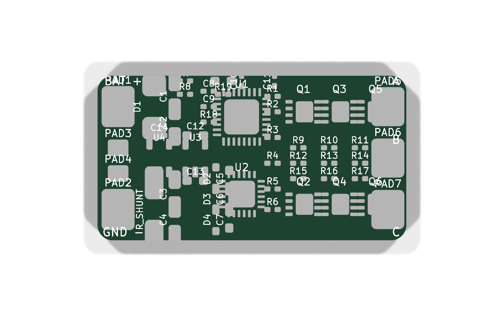
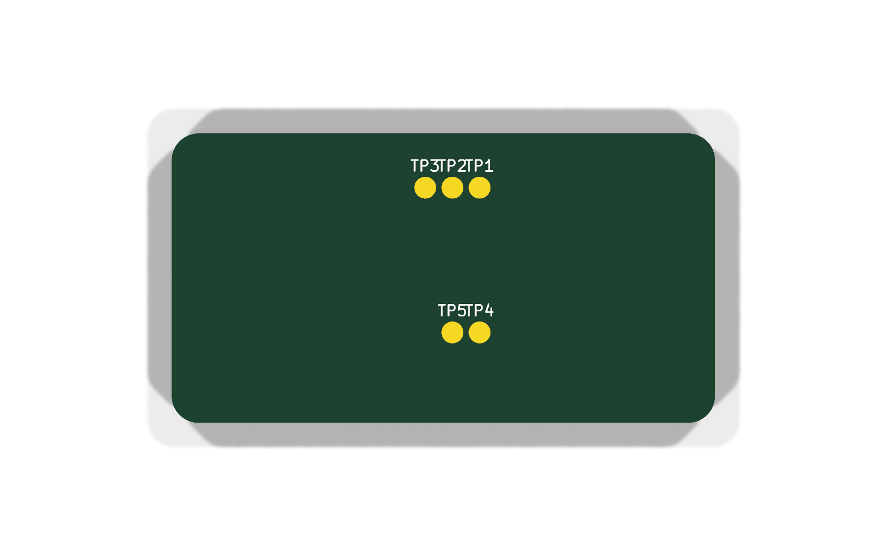
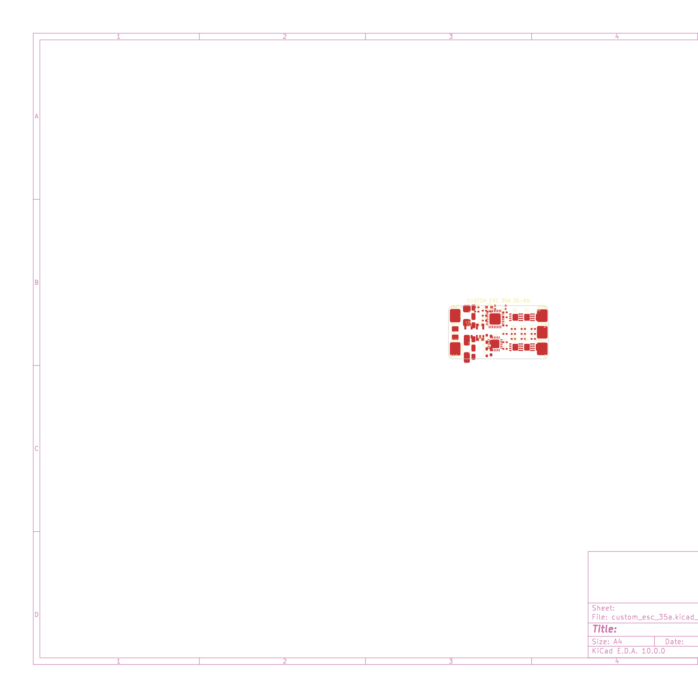
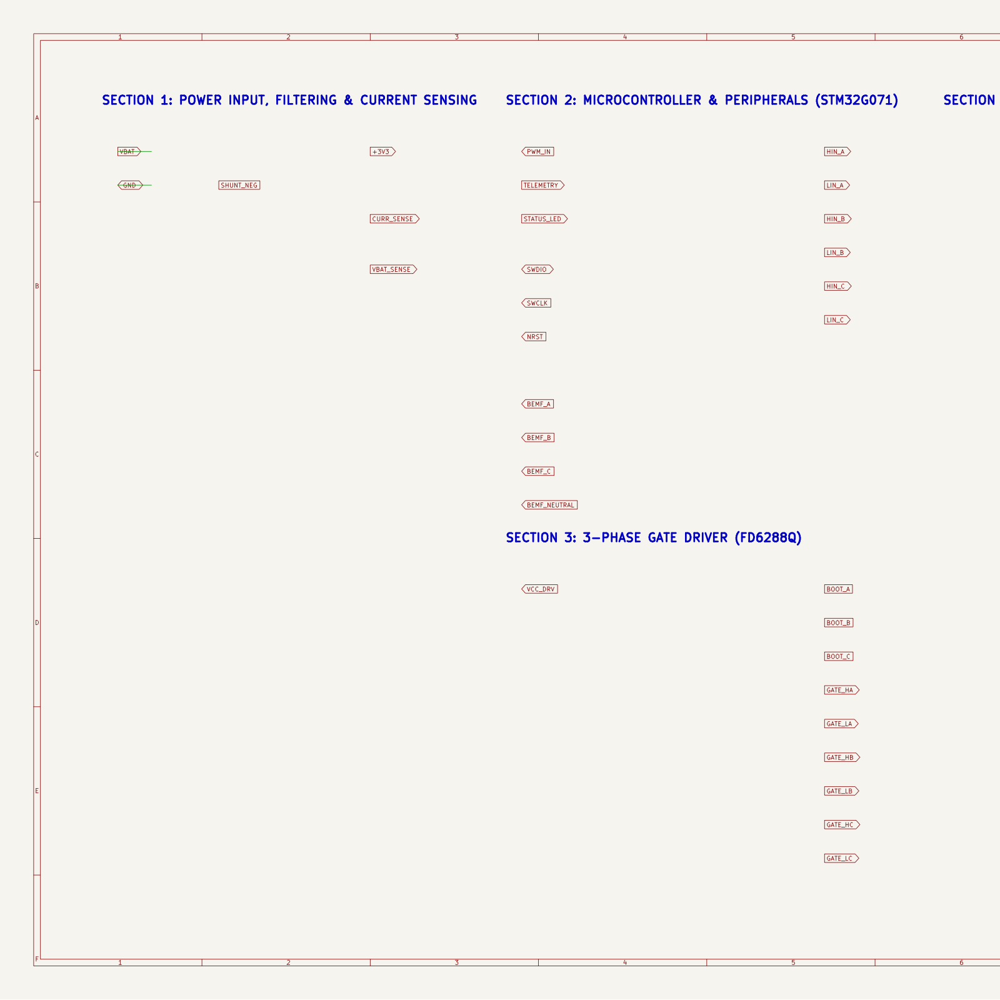

# Custom 3S–6S 35A/45A Single BLDC ESC

A custom, ultra-compact 4-layer brushless Electronic Speed Controller (ESC) designed for 5-inch drone arms and high-performance UAV actuation. Built around the 64MHz 32-bit ARM Cortex-M0+ **STM32G071KBT6** microcontroller, high-voltage **FD6288Q** 3-phase gate driver, and 6x low-RDS(on) 40V 60A Power DFN-8 MOSFETs.

This repository contains the **complete schematic and unrouted PCB layout** in KiCad, ready for manual trace routing or automated routing with FreeRouting.

---

## 3D Renders & Visual Previews

### 3D Top View (Unrouted Board)


### 3D Bottom View


### Unrouted 2D PCB Layout (Placement & Ratsnest)


### Complete Circuit Schematic


---

## Technical Specifications

| Parameter | Specification | Notes |
| :--- | :--- | :--- |
| **Input Voltage** | **3S to 6S LiPo** (9.0V – 25.2V) | Reverse/surge protected with SMBJ28A TVS |
| **Continuous Current** | **35A** | With active quadcopter propeller airflow |
| **Burst Current** | **45A** (10 seconds) | Thermal mass handled by 2oz copper planes |
| **Microcontroller (MCU)** | **STM32G071KBT6** (QFN-32) | 64MHz ARM Cortex-M0+, 128KB Flash, hardware dead-time timer |
| **Gate Driver** | **FD6288Q** (QFN-24 4x4mm) | Integrated 3-phase high/low side driver with bootstrap |
| **Power Inverter Bridge** | **6x N-Channel MOSFETs** (DFN-8 3.3x3.3mm) | 40V, 60A, RDS(on) 4.2mΩ (e.g. NCEP4060GU / AON7400) |
| **Current Sensing** | **INA180A1** (20V/V) + 0.5mΩ 2512 Shunt | Real-time telemetry current monitoring for FC |
| **Voltage Sensing** | 10k / 1k precision divider | Real-time battery voltage monitoring |
| **Commutation Method** | Sensorless BEMF Zero-Crossing | 3-phase resistive dividers + virtual star neutral point |
| **Control Protocol** | **DShot150 / 300 / 600, Proshot, PWM** | Supports bidirectional DShot RPM filtering |
| **Board Dimensions** | **30.0 mm × 16.0 mm** | Slim form-factor fits standard drone arms |
| **Layer Stackup** | **4-Layer FR-4 (1.6mm thickness)** | `F.Cu` (Signals/Power) / `In1.Cu` (GND) / `In2.Cu` (VBAT) / `B.Cu` (Phases) |

---

## System Architecture

```text
[ LiPo 3S-6S (9V-25.2V) ] ──► [ SMBJ28A TVS ] ──► [ 4x 10uF 50V Caps ] ──► [ High-Side FETs Q1, Q3, Q5 ]
                                      │                                                  │
                                      ▼                                                  ▼
                        [ SGM2203-3.3 High-V LDO ]                                 (Phase A, B, C)
                                      │                                                  │
                                      ▼                                                  ▼
                               [ STM32G071 MCU ]                             [ Low-Side FETs Q2, Q4, Q6 ]
                             (64MHz Cortex-M0+)                                          │
                                      │                                                  ▼
                                 (TIM1 PWM)                                     [ 0.5mΩ 2512 Shunt ]
                                      │                                                  │
                                      ▼                                                  ▼
                                [ FD6288Q Driver ] ──────────► [ Gate Damping ] ────►  [ GND ]
                               (3-Phase Inverter)                (6x 10Ω R)
```

---

## Bill of Materials (BOM)

| Qty | Component | Selected Part | Supplier | LCSC Part Number | Unit Price (USD) | Order Cost (USD) |
| :-: | :--- | :--- | :-: | :-: | --: | --: |
| 1 | STM32G071KBT6 MCU (ARM Cortex-M0+ 64MHz, 128KB Flash, QFN-32) | STM32G071KBT6 | LCSC | [C2836798](https://www.lcsc.com/product-detail/C2836798.html) | $1.45 | $1.45 |
| 1 | FD6288Q 3-Phase Gate Driver (QFN-24 4x4mm) | FD6288Q | LCSC | [C3005842](https://www.lcsc.com/product-detail/C3005842.html) | $0.48 | $0.48 |
| 1 | SGM2203-3.3 High-Voltage 36V LDO (SOT-23-5) | SGM2203-3.3 | LCSC | [C437523](https://www.lcsc.com/product-detail/C437523.html) | $0.22 | $0.22 |
| 1 | INA180A1 Current Sense Amplifier (SOT-23-5) | INA180A1IDBVR | LCSC | [C165682](https://www.lcsc.com/product-detail/C165682.html) | $0.45 | $0.45 |
| 6 | 40V 60A N-Channel Power MOSFETs (DFN-8 3.3x3.3mm) | NCEP4060GU | LCSC | [C144365](https://www.lcsc.com/product-detail/C144365.html) | $0.25 | $1.50 |
| 1 | SMBJ28A TVS Diode Clamp 600W (SMB) | SMBJ28A | LCSC | [C8536](https://www.lcsc.com/product-detail/C8536.html) | $0.12 | $0.12 |
| 3 | BAT54WS Fast Schottky Bootstrap Diodes (SOD-323) | BAT54WS | LCSC | [C8598](https://www.lcsc.com/product-detail/C8598.html) | $0.03 | $0.09 |
| 1 | Green SMD 0603 Status LED | LED 0603 | LCSC | [C84256](https://www.lcsc.com/product-detail/C84256.html) | $0.02 | $0.02 |
| 1 | 0.5mΩ 2W 1% Current Sense Shunt Resistor (2512) | WSL2512R0005FEA | LCSC | [C145524](https://www.lcsc.com/product-detail/C145524.html) | $0.35 | $0.35 |
| 4 | 10uF 50V Ceramic Capacitors (1206 X7R) | 10uF 50V 1206 | LCSC | [C13585](https://www.lcsc.com/product-detail/C13585.html) | $0.08 | $0.32 |
| 3 | 1uF 50V Bootstrap Ceramic Capacitors (0603 X7R) | 1uF 50V 0603 | LCSC | [C15849](https://www.lcsc.com/product-detail/C15849.html) | $0.02 | $0.06 |
| 4 | 100nF 16V Decoupling Ceramic Capacitors (0402 X7R) | 100nF 16V 0402 | LCSC | [C1525](https://www.lcsc.com/product-detail/C1525.html) | $0.005 | $0.02 |
| 1 | 1uF 50V LDO Input Capacitor (0603 X7R) | 1uF 50V 0603 | LCSC | [C15849](https://www.lcsc.com/product-detail/C15849.html) | $0.02 | $0.02 |
| 1 | 2.2uF 10V LDO Output Capacitor (0603 X7R) | 2.2uF 10V 0603 | LCSC | [C23630](https://www.lcsc.com/product-detail/C23630.html) | $0.03 | $0.03 |
| 1 | 100nF 16V CSA Filter Capacitor (0402 X7R) | 100nF 16V 0402 | LCSC | [C1525](https://www.lcsc.com/product-detail/C1525.html) | $0.005 | $0.005 |
| 6 | 10Ω 1% Gate Damping Resistors (0402) | 10R 0402 | LCSC | [C25077](https://www.lcsc.com/product-detail/C25077.html) | $0.005 | $0.03 |
| 1 | 10kΩ 0.1% Voltage Divider Top Resistor (0402) | 10k 0.1% 0402 | LCSC | [C25744](https://www.lcsc.com/product-detail/C25744.html) | $0.02 | $0.02 |
| 1 | 1kΩ 0.1% Voltage Divider Bottom Resistor (0402) | 1k 0.1% 0402 | LCSC | [C25741](https://www.lcsc.com/product-detail/C25741.html) | $0.02 | $0.02 |
| 3 | 10kΩ 1% BEMF Voltage Divider Top Resistors (0402) | 10k 1% 0402 | LCSC | [C25744](https://www.lcsc.com/product-detail/C25744.html) | $0.005 | $0.015 |
| 3 | 2.2kΩ 1% BEMF Voltage Divider Bottom Resistors (0402) | 2.2k 1% 0402 | LCSC | [C25879](https://www.lcsc.com/product-detail/C25879.html) | $0.005 | $0.015 |
| 3 | 10kΩ 1% Virtual Neutral Star Resistors (0402) | 10k 1% 0402 | LCSC | [C25744](https://www.lcsc.com/product-detail/C25744.html) | $0.005 | $0.015 |
| 1 | 100Ω 1% PWM Input Protection Resistor (0402) | 100R 0402 | LCSC | [C25076](https://www.lcsc.com/product-detail/C25076.html) | $0.005 | $0.005 |
| 1 | 1kΩ 1% LED Current Limiting Resistor (0402) | 1k 0402 | LCSC | [C25741](https://www.lcsc.com/product-detail/C25741.html) | $0.005 | $0.005 |
| 5 | Custom 4-Layer Bare PCB (30x16mm, JLCPCB JLC04161H Stackup) | Custom PCB | JLCPCB | [JLCPCB](https://jlcpcb.com) | $0.80 | $4.00 |
| **—** | **Total Components Cost** | | **LCSC** | | | **$5.25** |
| **—** | **Total Procurement Cost (Components + 5x PCBs)** | | **LCSC + JLCPCB** | | | **~$9.25** |

---

## How to Route the Board in KiCad / FreeRouting

The board is intentionally provided in an **unrouted** state with all footprints and net connections already fully assigned:

1. **Open the project in KiCad:**
   Open `custom_esc_35a.kicad_pro` inside KiCad 10.
2. **Open PCB Editor (`custom_esc_35a.kicad_pcb`):**
   You will see the 30x16mm board outline with components placed in their ideal electrical zones and the ratsnest lines active.
3. **Route Manually or with FreeRouting:**
   - **Manual Routing:** Press `X` in KiCad PCB Editor to route copper traces. Use 0.2mm for signal nets and copper polygon fills (press `B`) for `VBAT`, `GND`, and the three motor phase nets (`MOT_A`, `MOT_B`, `MOT_C`).
   - **Auto-routing with FreeRouting:**
     * Export Specctra DSN: `File → Export → Specctra DSN...`
     * Open FreeRouting: Run `/Users/divyanshuprakash/.gemini/antigravity/bin/freerouting`
     * Load DSN and click **Autoroute**.
     * Once finished, save `.ses` and import in KiCad via `File → Import → Specctra Session...`.
